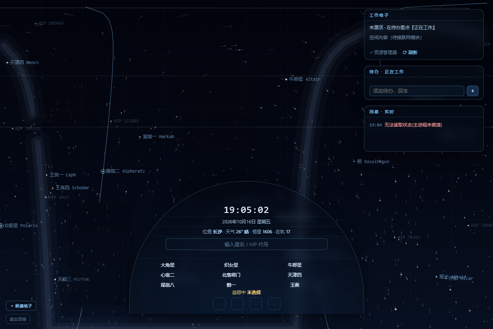
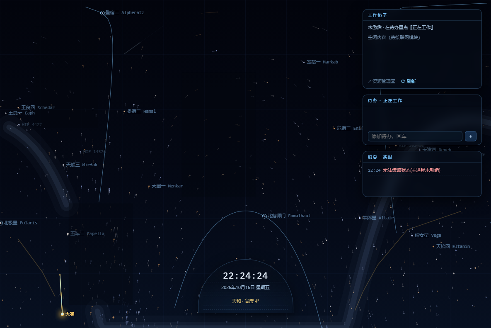
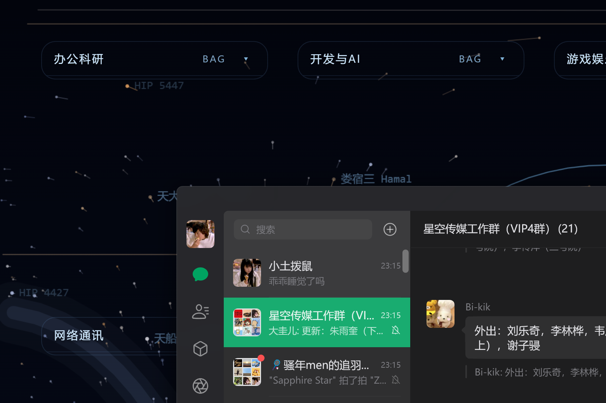

# 星穹桌面 · SkyDome Desktop

> 把**动态星空壁纸 + 桌面文件格子 + 信息浮层**合并成**单一程序**的 Windows 桌面增强工具。
> 基于 Electron，免安装、纯自绘，星图随**你的位置与当前时刻**实时演算。



---

## ✨ 功能特性

- 🌌 **实时动态星空壁纸**：按你所在城市（经纬度）与当前日期时刻计算真实天象；星轨、银河、卫星、中国空间站（天和）都在正确位置。加速播放时**只在本日内循环**（到 24:00 回到 00:00）。
- 🗂 **桌面标签栏格子**：屏幕顶部一排标签（像浏览器标签页），**不挡壁纸**；鼠标移上去向下展开文件列表，**图标随数量自适应**（少→大、多→小）。
- 🖱 **完整文件操作**：单击打开 / 右键菜单（打开、资源管理器显示、**移出格子**、**转移到其他格子**、**打开目标文件位置**、**删除到回收站**、重命名、新建/删除格子）、拖入文件、拖拽整理。
- 📋 **右列面板**
  - **工作格子**：有待办标「正在工作」时显示其关联文件夹；空闲时显示**快捷方式**（网址/软件/文件，可增删改名，网址内藏）。
  - **待办**：可勾选完成、双击改名、关联文件夹。
  - **消息**：分「通知 / 搜索」两个独立标签，可滚动查看最近 20 条；支持右键（打开文件位置 / 收纳到格子 / 删除）。
- 🔍 **文件搜索**：消息面板底部输入关键字回车 → 搜索桌面与下载目录 → 结果以消息返回，点击直接打开所在文件夹。
- 🔘 **中央半圆控制台**：常驻只显 时钟 + 日期 + 天和状态；悬停展开 → 星球搜索、星表、点击追踪、**时间流速**、**一键回到普通桌面**、**⚙ 设置**。
- 🧭 **一键回到普通桌面**：临时隐藏星穹露出真实桌面，右下角可一键返回（同时暂停渲染省电）。
- 🔔 **新文件提醒**：桌面/下载/微信出现**未收纳**的新文件或文件夹 → 消息提醒，**点击即可收纳到指定格子**。
- ⚙️ **设置面板**：城市/经纬度、时间流速、开机自启、面板显隐、**按分类重建格子**（一键把桌面软件按类别归入格子）、**设为 Windows 壁纸**（静态导出，可选每 N 分钟自动更新）。
- ⚡ **低占用**：约 0.9% CPU（14 核全系统）、约 7% GPU；离屏场景缓存 + 逐星缓存 + 按需重绘。

| 中央控制台（悬停展开） | 桌面分类格子 |
|---|---|
|  |  |

---

## 🚀 快速开始

### 方式一：直接使用（免安装）

1. 到 [Releases](../../releases) 下载 `星穹桌面.zip`
2. 解压后双击 **`星穹桌面.exe`**
3. 首次运行可能被 SmartScreen 拦（未签名）→「更多信息 → 仍要运行」
4. 打开控制台（鼠标移到屏幕**最下方中央**的小半圆）→ **⚙ 设置** → **按分类重建格子**

> 要求：Windows 10 / 11 64 位。

### 方式二：从源码运行（开发）

```bash
git clone https://github.com/EoTToE/skydome-desktop.git
cd skydome-desktop
npm install
npm start
```

打包成免安装程序见 [docs/BUILD.md](docs/BUILD.md)。

---

## ⚙️ 设置说明

| 项 | 说明 |
|---|---|
| 城市 / 纬度 / 经度 | 计算星穹的天文位置（默认 长沙 28.23, 112.94） |
| 时间流速 | `实时(×1)` = 与此刻真实天象一致；`×30/×120…` = 在本日内加速循环 |
| 开机自启 | 写入 `HKCU\...\Run`（当前用户，免管理员） |
| 显示右列 / 格子 | 面板显隐 |
| 按分类重建格子 | 扫描桌面，按 办公科研 / 开发与AI / 游戏娱乐 / 网络通讯 / 工具与媒体 / 文件夹 归类 |
| 设为 Windows 壁纸 | 把当前星空导出为静态 PNG 写入系统壁纸；UAC/锁屏可见；**设好后可关掉程序，CPU/GPU 归零** |
| 静态壁纸自动更新 | 每 N 分钟重导一次，跟着天象走 |

**URL 调试钩子**（开发用）：`#probe` 显示悬停框、`#track=<HIP>` 追踪某星、`#q=<星名>` 预填搜索。

---

## 🧱 技术要点

- **单窗口范式**：整个应用只有一个 Electron 窗口（`transparent` + `frame:false`），星空 canvas、面板、格子、控制台都在同一页 —— 避免多窗口 Z 序互斗。
- **桌面层**：窗口通过 `SetWindowPos(HWND_BOTTOM)` 沉底 + `IsIconic` 防 Win+D，活在应用窗之下、任务栏之上。
- **分区点击穿透**：主进程每 40ms 轮询全局光标，命中渲染进程上报的交互矩形（`ResizeObserver` + 防抖重报）才吃鼠标，其余穿透到桌面。
- **悬停靠全局光标驱动**：穿透态下 renderer 收不到鼠标事件，故星悬停与控制台展开都由主进程下发的全局光标驱动。
- **真实星图**：Hipparcos 星表（1606 颗亮星）+ 本地恒星时/地平坐标变换 + TLE 卫星轨道。
- **性能**：离屏场景缓存（重活 1.5s 一次）、逐星 altAz 单遍缓存、天和轨道 1s、卫星 4Hz、按需 rAF。

---

## 📁 目录结构

```
.
├─ main.js          # 主进程：窗口/层级/穿透轮询/HTTP(17650)/IPC/状态/图标/分类/壁纸
├─ preload.js       # contextBridge 暴露 window.shell
├─ renderer.js      # 渲染进程：面板/格子/控制台/设置/交互
├─ index.html       # 单页：星空 canvas + 面板 + 格子 + 控制台
├─ sky-engine.js    # 星穹引擎：星表/坐标/银河/卫星/流星/渲染
├─ sky.html         # 纯星空页（调试用）
├─ _lib/            # hipparcos_5.js 星表、satellite.min.js
├─ docs/BUILD.md    # 打包说明
└─ assets/          # 截图
```

运行时状态：`data/state.json`（**单一写者 = 主进程**，未知键原样保留）。

---

## ❓ FAQ

- **图标不显示/不清晰？** 优先取快捷方式指定的设计图标（`.ico`→256px / `.exe`→48px / `.lnk`→shell 兜底），缓存于 `%APPDATA%/desktop-shell/icon-cache`。
- **星图和此刻不一致？** 确认「时间流速」为**实时**；加速模式会在本日内循环。
- **点桌面空白没反应？** 空白处是穿透的（设计如此），只有面板/格子/控制台吃点击。
- **UAC/权限弹窗时壁纸变回默认？** 那是 Windows 安全桌面，第三方程序无法绘制；用「设为 Windows 壁纸」可让那里也显示同一片星空（静态）。
- **怎么卸载？** 删除程序文件夹即可；如开了自启，先在设置里关掉。

---

## 📄 许可证

[MIT](LICENSE) © 2025 星穹桌面 contributors

## 🙏 致谢

- 星表：[Hipparcos](https://www.cosmos.esa.int/web/hipparcos)
- 卫星 TLE：[CelesTrak](https://celestrak.org/)
- 天气：[Open-Meteo](https://open-meteo.com/)
- 运行时：[Electron](https://www.electronjs.org/)、原生调用：[koffi](https://koffi.dev/)
